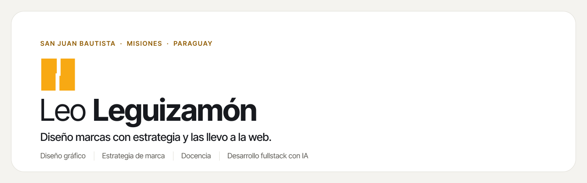

<picture>
  <source media="(prefers-color-scheme: dark)" srcset="img/banner_dark.svg">
  
</picture>

 

Soy diseñador gráfico, estratega de marca y docente en el **SNPP**. Desde San Juan Bautista, Misiones, acompaño a marcas y proyectos del lugar en todo el recorrido: la identidad, las campañas, las redes y la web. Y programo: desarrollo sitios y herramientas propias con IA para hacer ese trabajo mejor y más rápido.

## Qué hago

<table>
<tr>
<td width="25%" valign="top"><b>Identidad de marca</b> Estrategia, logotipo, sistema visual y manual de uso.</td>
<td width="25%" valign="top"><b>Campañas</b> Concepto, piezas y coherencia en cada canal.</td>
<td width="25%" valign="top"><b>Redes sociales</b> Línea gráfica, contenidos y calendario.</td>
<td width="25%" valign="top"><b>Web</b> Sitios a medida, rápidos y fieles a la marca.</td>
</tr>
</table>

## Enseño

Doy clases en el **Servicio Nacional de Promoción Profesional (SNPP)**: formación práctica en diseño y comunicación digital, para que más gente pueda trabajar con estas herramientas.

## Con qué trabajo

## Cómo trabajo

> **Implementado ≠ probado ≠ validado con casos reales.**

Lo que entrego dice qué está medido y qué es una opinión de diseño. Trabajo por etapas, con pruebas en cada cambio, y reviso cada entrega antes de que llegue al cliente.

---

**Leo Leguizamón** · [leoleguizamon.com](https://leoleguizamon.com) · [leoleguizamon.cloud](https://leoleguizamon.cloud) &nbsp;—&nbsp; Diseño de marca y desarrollo web, desde Paraguay.
