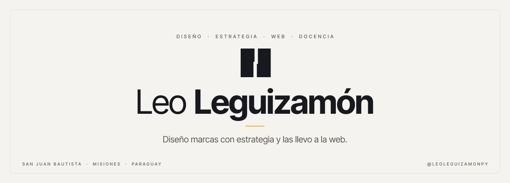
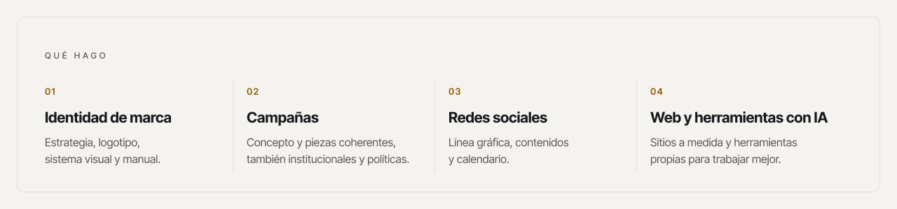
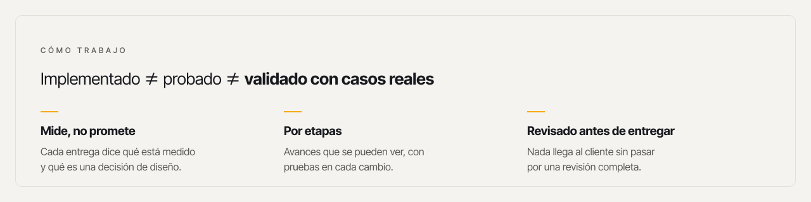

<picture>
  <source media="(prefers-color-scheme: dark)" srcset="img/banner_dark.svg">
  
</picture>

  
  
  
  

  Diseñador gráfico, estratega de marca y docente en el <b>SNPP</b>. 
  Desde San Juan Bautista, Misiones, acompaño a marcas, instituciones y proyectos en todo el recorrido: 
  la identidad, las campañas, las redes y la web. Y programo: desarrollo sitios y herramientas propias con IA.

<picture>
  <source media="(prefers-color-scheme: dark)" srcset="img/servicios_dark.svg">
  
</picture>

## Enseño

En el **Servicio Nacional de Promoción Profesional (SNPP)** doy formación práctica en diseño y comunicación digital, como el curso de **Community Manager**: estrategia, contenidos y gestión de redes, para que más gente pueda trabajar con estas herramientas.

## Con qué trabajo

  
  
  
  
  
  
  
  
  
  

<picture>
  <source media="(prefers-color-scheme: dark)" srcset="img/principios_dark.svg">
  
</picture>

  <b>Leo Leguizamón</b> · <a href="https://leoleguizamon.com">leoleguizamon.com</a> · <a href="https://leoleguizamon.cloud">leoleguizamon.cloud</a> &nbsp;—&nbsp; Diseño de marca y desarrollo web, desde Paraguay.

